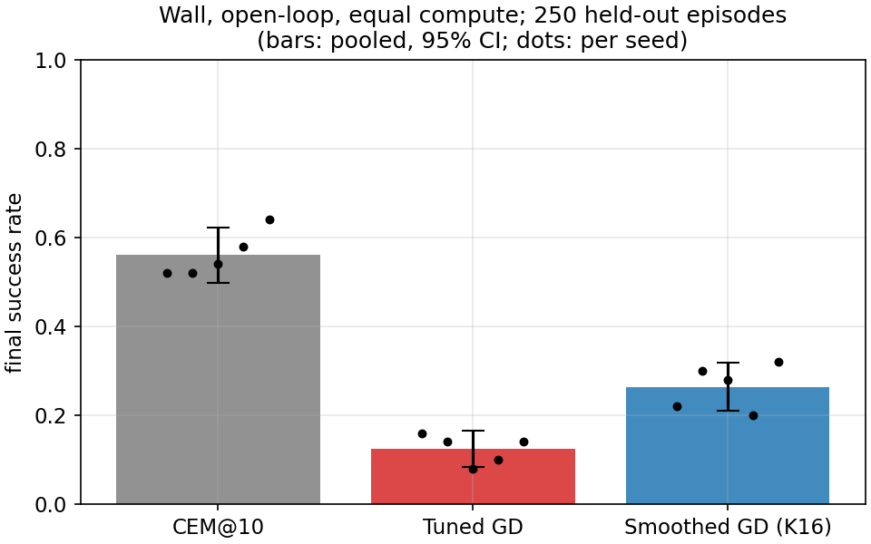
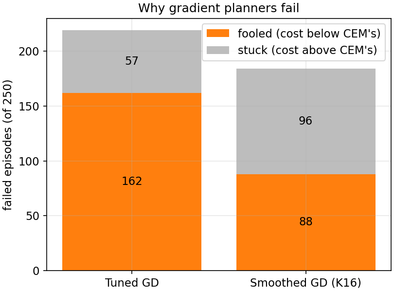
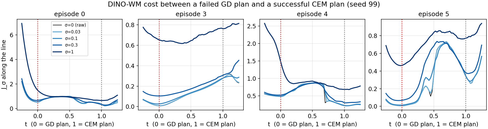
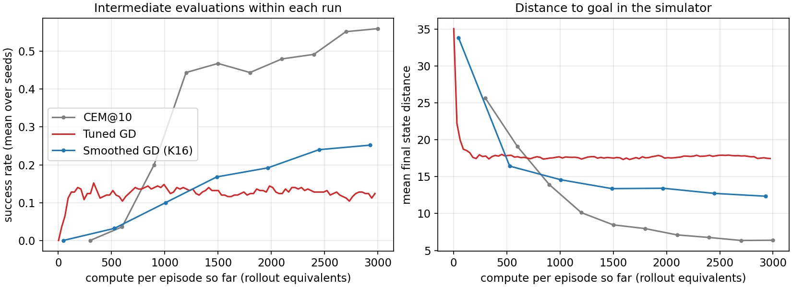

# Gaussian-Smoothed Gradient Planning for DINO-WM

Gradient-based planning through a learned world model is fast, but on
[DINO-WM](https://dino-wm.github.io/) it fails far more often than sampling-based CEM. This project
replaces the planner's gradient with the gradient of a **Gaussian-smoothed planning cost** and
tests the change with pre-registered, equal-compute comparisons on held-out episodes.

**Result (Wall task, 250 held-out episodes, equal compute):** smoothing more than doubles the
success of tuned gradient descent, **0.12 → 0.26** (exact McNemar p = 2e-5, confirmed on fresh
pre-registered seeds), and halves the "fooled" failures where the world model rates a failing plan
better than CEM's. CEM remains stronger (0.56).

| Planner (3,000 rollout-equivalents / episode) | Success (95% CI) | Mean final distance | Fooled failures |
|---|---|---|---|
| CEM, 10 iterations | 0.56 [0.50, 0.62] | 6.4 | (reference) |
| Gradient descent, tuned (Adam) | 0.12 [0.08, 0.16] | 17.5 | 162 |
| **Smoothed gradient descent, K = 16** | **0.26 [0.21, 0.32]** | **12.5** | **88** |

<p align="center">
  
  
</p>

## Method

DINO-WM (Zhou, Pan, LeCun, Pinto, ICML 2025) plans by minimizing a cost J(a) between the
predicted and the goal DINOv2 features over an action sequence a. The learned cost is rugged:
gradient descent lands in narrow minima that the model rates highly but that fail in the simulator.
Smoothed GD follows the gradient of

    J_sigma(a) = E_{eps ~ N(0, I)} [ J(a + sigma * eps) ],
    grad J_sigma(a) ≈ (1/K) * sum_k grad J(a + sigma * eps_k)     (antithetic pairs ±eps_k)

with sigma annealed geometrically from sigma0 to sigma_min ([planning/smooth_gd.py](planning/smooth_gd.py)).
The returned plan is always the unperturbed center; the world model is frozen and unchanged.

The cost between a failed GD plan (t = 0) and a successful CEM plan (t = 1): the raw cost
(black) has narrow dips that larger sigma flattens.



Success and distance during optimization, averaged over the held-out seeds:



**Evaluation protocol.** Hyperparameters were tuned on seed 99 only; held-out seeds 101/103
were run with the analysis fixed in advance, and the result was then replicated on fresh seeds
107/109/113 under a committed pre-registration ([docs/replication_preregistration.md](docs/replication_preregistration.md)):
smoothed vs tuned GD, 32 vs 8 discordant episodes, p = 0.00018. Compute is counted in
hardware-independent rollout equivalents ([planning/compute.py](planning/compute.py)), and the
upstream "oracle stop" (stopping once the simulator reports success) is disabled.

This repository is the authors' released code (MIT license, upstream history up to commit
`0a9492f`) plus my changes.

## Quick start

```bash
pip install -r requirements.txt            # Python 3.9 (or: conda env create -f environment.yaml)

python main.py all                         # CPU, < 1 min: test + toy + analyze, writes outputs/
python main.py test                        # unit tests of the planners on a fake world model
python main.py toy  --K 8 --sigma0 0.3     # smoothed vs plain GD on a bumpy fake model
python main.py analyze                     # every results table and figure, from results/
python main.py demo --n-evals 20           # real DINO-WM on Wall episodes (GPU, ~26 min)
python main.py <mode> -h                   # all parameters of a mode
```

`demo` needs the dataset and the checkpoint (see `data.txt`, `model.txt`):
`export DATASET_DIR=/path/to/data DINO_WM_CKPT=/path/to/ckpt`.

### Outputs (`outputs/`, written by `main.py`; not tracked in git)

| File | Content |
|---|---|
| `key_metrics.md` | success (95% CI), final distance, model cost, fooled/stuck failures, compute, time per planner |
| `replication_report.md` | pre-registered test on fresh seeds 107/109/113 (`docs/replication_preregistration.md`) |
| `phase6_report.md` | first held-out evaluation (seeds 101/103) |
| `summary.md`, `summary.csv` | every saved run, grouped by configuration |
| `budget_curve.md`, `rescore_report.md`, `probe_report.md` | budget sweep, smoothed-cost rescoring, cost-landscape probe (seed 99) |
| `fig_success.png`, `fig_failure_types.png`, `fig_progress.png`, `fig_distance_cdf.png`, `fig_landscape.png` | figures (copies of the main ones in `docs/figures/`) |
| `toy_*.png`, `toy_summary.md` | fake-model illustration |
| `test_log.txt` | unit test output |
| `demo/` | the demo run: per-planner `logs.json` (every intermediate evaluation), `episodes.jsonl` (per episode), `run_stats.json`, rollout images, `demo_progress.png` |

## What I changed

Every change to an upstream file is marked inline with `# [MOD]`; every file I wrote starts with
`# [NEW]`. List them with `grep -rn "\[MOD\]" --include=*.py --include=*.yaml .`, or see
`git diff 0a9492f HEAD`.

**New: the modification**
- `planning/smooth_gd.py`: the smoothed-gradient planner (K perturbations per step, antithetic
  sampling, sigma schedules const / linear / geom). The plan that is evaluated and returned is
  always the unperturbed center.
- `conf/planner/smooth_gd.yaml`: its settings.

**Changed upstream files**
- `planning/gd.py`: Adam option, random restarts (best restart chosen by model cost, never by the
  simulator), init scale, chunked backprop (same gradient, less memory), optional oracle stop.
  These make tuned GD a fair baseline and are reused by the smoothed planner.
- `planning/cem.py`: chunked rollouts (same result), optional oracle stop.
- `planning/evaluator.py`: per-episode success, distance and model cost written to
  `episodes.jsonl`; decoder run without autograd (memory).
- `plan.py`: compute counters, timing and git state in `run_stats.json`; saves the final plan;
  world-model weights frozen; W&B logging off.
- `models/dino.py`: DINOv2 hub repo pinned to a fixed commit.
- `conf/plan*.yaml`, `conf/planner/gd.yaml`: run-folder names, checkpoint path from
  `$DINO_WM_CKPT`, new GD options.

`oracle_stop`: upstream stops planning as soon as the *simulator* reports all episodes solved,
which a real planner cannot know. All results here use `oracle_stop=false` (fixed budget).

**New: evaluation tooling**
- `planning/compute.py`: hardware-independent compute counter (`plan_equiv`: one rollout = 1,
  one backward = 2), so all planners are compared at equal compute (3,000 per episode).
- `planning/probe.py`, `planning/rescore.py`: cost-landscape probe and smoothed-cost rescoring
  (analysis only, no planning).
- `scripts/`: experiment launchers (`*.sh`) and analysis (`*_report.py`, `collect_results.py`,
  `episode_rates.py`, `budget_curve.py`).
- `tests/`: planner tests on a small fake world model (e.g. K=1, sigma=0 reproduces GD exactly;
  the K-sample gradient matches the exact smoothed gradient on a quadratic cost).
- `main.py`: the entry point above.

## Results and reproducing them

`results/wall/<planner>_s<seed>/` holds every run behind the results above (configuration, per-step
logs, per-episode outcomes, compute stats, final plans). The raw outputs and plan-target pickles
are not included (size), so `analyze` reports the "same starts/goals" check as not checked.
All runs were produced at commit `8a57349` with a clean tree; later commits only added comments
and documentation.

Full experiments (GPU hours, one Quadro RTX 6000, ~12-17 min per planner per 50 episodes):

```bash
export CKPT=/path/to/ckpt DATASET_DIR=/path/to/data          # the launchers read CKPT
STAGE=A bash scripts/phase3_sweep.sh   # tuning on seed 99 (stages A-C and phase 5:
bash scripts/phase5_sweep.sh           #   see the usage notes at the top of each script)
bash scripts/phase6_heldout.sh         # held-out seeds 101, 103
bash scripts/replication_run.sh        # fresh seeds 107, 109, 113
python main.py analyze
```

Single planning run, e.g. smoothed GD with K = 16:
```bash
python plan.py --config-name plan_wall model_name=wall_single planner=smooth_gd planner.K=16 \
  planner.opt_steps=62 planner.optimizer=adam planner.lr=0.1 planner.sigma0=1 planner.sigma_min=0.1 \
  planner.sigma_schedule=geom +planner.oracle_stop=false goal_source=random_state goal_H=5 n_evals=50 seed=107
```

## External code

Not written by me: everything upstream of commit `0a9492f` (DINO-WM, Zhou et al., MIT
license): world model, training, environments, datasets, CEM/GD/MPC planners, evaluator. The
DINOv2 encoder (Oquab et al.) is loaded via torch.hub. Libraries: PyTorch, Hydra, NumPy, SciPy
(exact binomial test), Matplotlib.

---

# Original DINO-WM README (upstream)

# **DINO-WM**: World Models on Pre-trained Visual Features enable Zero-shot Planning
[[Paper]](https://arxiv.org/abs/2411.04983) [[Code]]() [[Data]](https://osf.io/bmw48/?view_only=a56a296ce3b24cceaf408383a175ce28) [[Project Website]](https://dino-wm.github.io/) 

[Gaoyue Zhou](https://gaoyuezhou.github.io/), [Hengkai Pan](https://hengkaipan.github.io/), [Yann LeCun](https://yann.lecun.com/) and [Lerrel Pinto](https://www.lerrelpinto.com/), New York University, Meta AI


# Getting Started

1. [Installation](#installation)
2. [Datasets](#datasets)
3. [Train a DINO-WM](#train-a-dino-wm)
4. [Plan with a DINO-WM](#plan-with-a-dino-wm)

## Installation

Setup an environment
```bash
git clone https://github.com/gaoyuezhou/dino_wm.git
cd dino_wm
conda env create -f environment.yaml
conda activate dino_wm
```

### Install Mujoco
                    
Create the `.mujoco` directory and download Mujoco210 using `wget`:

```bash
mkdir -p ~/.mujoco
wget https://mujoco.org/download/mujoco210-linux-x86_64.tar.gz -P ~/.mujoco/
cd ~/.mujoco
tar -xzvf mujoco210-linux-x86_64.tar.gz
```

Append the following lines to your `~/.bashrc`:

```bash
# Mujoco Path. Replace `<username>` with your actual username if necessary.
export LD_LIBRARY_PATH=$LD_LIBRARY_PATH:/home/<username>/.mujoco/mujoco210/bin

# NVIDIA Library Path (if using NVIDIA GPUs)
export LD_LIBRARY_PATH=$LD_LIBRARY_PATH:/usr/lib/nvidia
```

Reload your shell configuration to apply the environment variable changes:

```bash
source ~/.bashrc
```

#### Notes
- For GPU-accelerated simulations, ensure the NVIDIA drivers are correctly installed.
- If you encounter issues, confirm that the paths in your `LD_LIBRARY_PATH` are correct.
- If problems persist, refer to these GitHub issue pages for potential solutions: [openai/mujoco-py#773](https://github.com/openai/mujoco-py/issues/773), [ethz-asl/reinmav-gym#35](https://github.com/ethz-asl/reinmav-gym/issues/35).


The following are optional installation steps for planning in the deformable environments.

### Install PyFlex (optional for deformable environments)

Install PyFleX if you need to plan within the deformable environments. These installation instructions are adapted from [AdaptiGraph](https://github.com/Boey-li/AdaptiGraph/tree/main).

We are using a docker image to compile PyFleX. Make sure you have the following packages:
- [docker-ce](https://docs.docker.com/engine/install/ubuntu/)
- [nvidia-docker](https://github.com/NVIDIA/nvidia-docker#quickstart)

Full installation:
```bash
pip install "pybind11[global]"
sudo docker pull xingyu/softgym
```
Run `bash install_pyflex.sh`. You may need to `source ~/.bashrc` to `import PyFleX`.

Or you can manually run
```bash
# compile pyflex in docker image
# re-compile if source code changed
# make sure ${PWD}/PyFleX is the pyflex root path when re-compiling
sudo docker run \
    -v ${PWD}/PyFleX:/workspace/PyFleX \
    -v ${CONDA_PREFIX}:/workspace/anaconda \
    -v /tmp/.X11-unix:/tmp/.X11-unix \
    --gpus all \
    -e DISPLAY=$DISPLAY \
    -e QT_X11_NO_MITSHM=1 \
    -it xingyu/softgym:latest bash \
    -c "export PATH=/workspace/anaconda/bin:$PATH; cd /workspace/PyFleX; export PYFLEXROOT=/workspace/PyFleX; export PYTHONPATH=/workspace/PyFleX/bindings/build:$PYTHONPATH; export LD_LIBRARY_PATH=$PYFLEXROOT/external/SDL2-2.0.4/lib/x64:$LD_LIBRARY_PATH; cd bindings; mkdir build; cd build; /usr/bin/cmake ..; make -j"

# import to system paths. run these if you do not have these paths yet in ~/.bashrc
echo '# PyFleX' >> ~/.bashrc
echo "export PYFLEXROOT=${PWD}/PyFleX" >> ~/.bashrc
echo 'export PYTHONPATH=${PYFLEXROOT}/bindings/build:$PYTHONPATH' >> ~/.bashrc
echo 'export LD_LIBRARY_PATH=${PYFLEXROOT}/external/SDL2-2.0.4/lib/x64:$LD_LIBRARY_PATH' >> ~/.bashrc
echo '' >> ~/.bashrc
```

# Datasets

Dataset for each task can be downloaded [here](https://osf.io/bmw48/?view_only=a56a296ce3b24cceaf408383a175ce28). 

Once the datasets are downloaded, unzip them. For the deformable dataset, you need to combine all parts and then unzip:
```
zip -s- deformable.zip -O deformable_full.zip
unzip deformable_full.zip
```

Set an environment variable pointing to your dataset folder:
```bash
# Replace /path/to/data with the actual path to your dataset folder.
export DATASET_DIR=/path/to/data
```
Inside the dataset folder, you should find the following structure:
```
data
├── deformable
│   ├── granular
│   └── rope
├── point_maze
├── pusht_noise
└── wall_single
```


# Train a DINO-WM
Once you have completed the above steps, you can check whether you could launch training with an example command like this:

```
python train.py --config-name train.yaml env=point_maze frameskip=5 num_hist=3
```
You may specify models' output directory at `ckpt_base_path` in `conf/train.yaml`.

# Plan with a DINO-WM
Once a world model has been trained, you may use it for planning with an example command like this:

```
python plan.py model_name=<model_name> n_evals=5 planner=cem goal_H=5 goal_source='random_state' planner.opt_steps=30
```

where the model is saved at folder `<ckpt_base_path>/outputs/<model_name>`, and `<ckpt_base_path>` can be specified in `conf/plan.yaml`.

<!-- ## Acknowledgement
TODO -->

# Pre-trained Model Checkpoints

We have uploaded our trained world model checkpoints for PointMaze, PushT, and Wall [here](https://osf.io/bmw48/?view_only=a56a296ce3b24cceaf408383a175ce28) under `checkpoints`. You can launch planning jobs with their respective configs in the repo:

First, update `ckpt_base_path` to where the checkpoints are saved in the plan configs.

Then launch planning runs with the following commands:
```bash
# PointMaze
python plan.py --config-name plan_point_maze.yaml model_name=point_maze
# PushT
python plan.py --config-name plan_pusht.yaml model_name=pusht
# Wall
python plan.py --config-name plan_wall.yaml model_name=wall
```

Planning logs and visualizations can be found in `./plan_outputs`.


## Citation

```
@misc{zhou2024dinowmworldmodelspretrained,
      title={DINO-WM: World Models on Pre-trained Visual Features enable Zero-shot Planning}, 
      author={Gaoyue Zhou and Hengkai Pan and Yann LeCun and Lerrel Pinto},
      year={2024},
      eprint={2411.04983},
      archivePrefix={arXiv},
      primaryClass={cs.RO},
      url={https://arxiv.org/abs/2411.04983}, 
}
```
